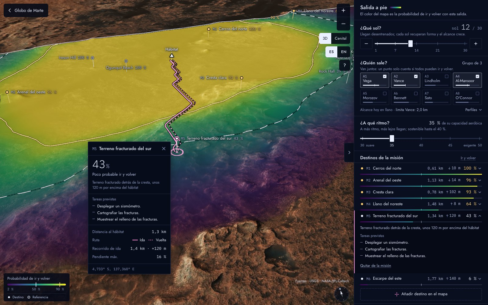
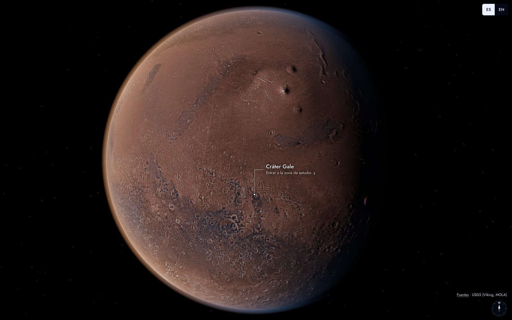
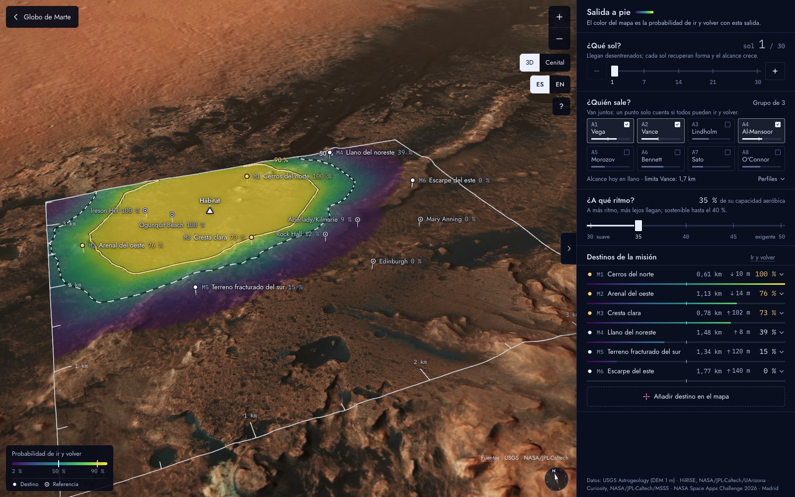
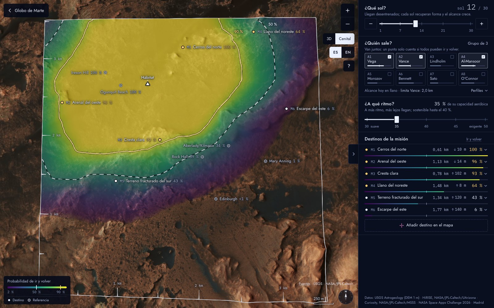
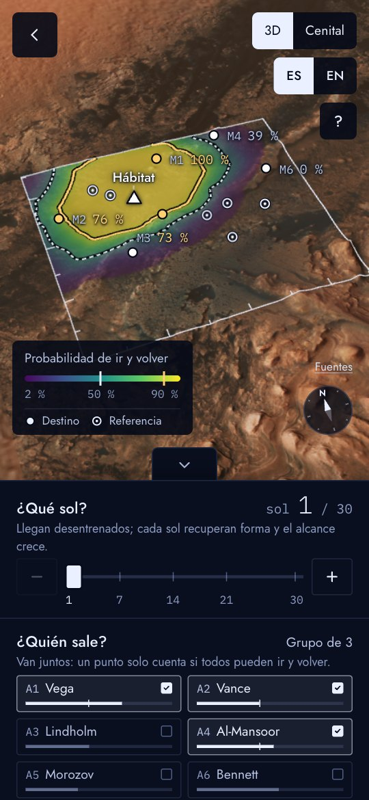
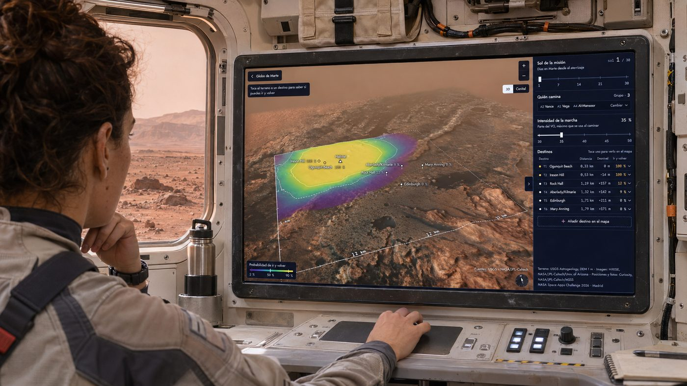
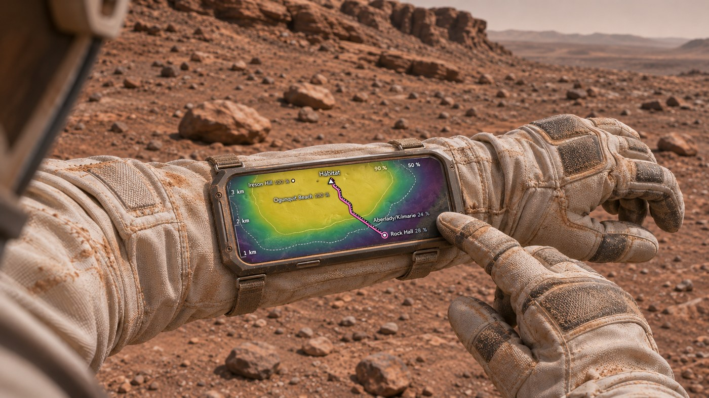
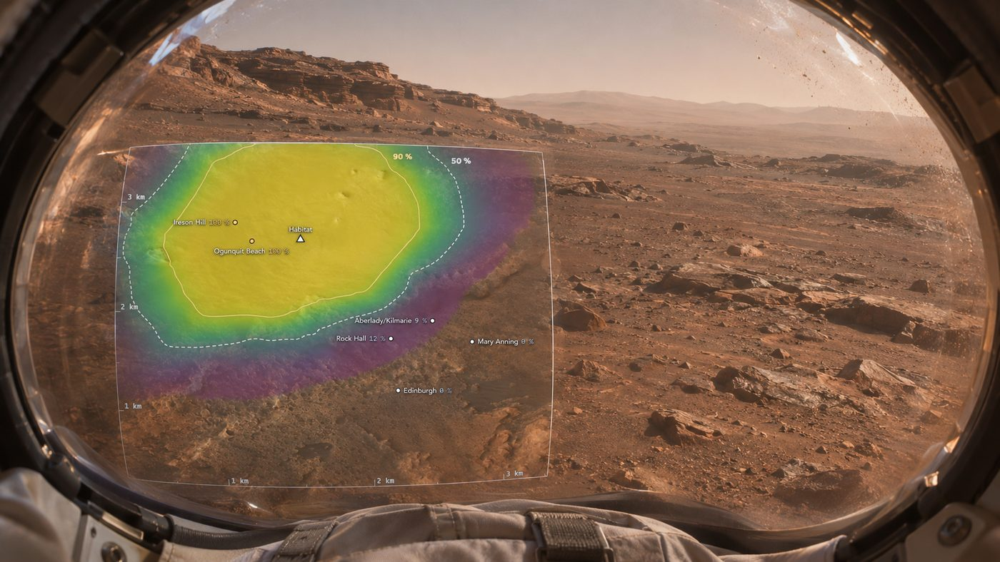

<div align="center">

# Land & Stand

**El mapa de Marte según el cuerpo que lo pisa**

Proyecto para el [NASA Space Apps Challenge 2026](https://www.spaceappschallenge.org/2026/) · Madrid<br>
Reto [*Interplanetary survival guide: Martian map*](https://www.spaceappschallenge.org/2026/challenges/interplanetary-survival-guide-martian-map/)


[English](README.md) · **Español**

</div>



> *Every team will map Mars. We map Mars as it looks to a body just back from six months in zero gravity.*

Los primeros astronautas que pisen Marte llegarán tras unos seis meses sin gravedad: con menos forma aeróbica, peor equilibrio y menos fuerza, y esos déficits tardan días o semanas en pasar. Además, la Tierra queda a hasta 24 minutos de radio, así que nadie puede guiarles en directo.

**Land & Stand** muestra, sobre el terreno real del cráter Gale, **qué probabilidad tiene cada tripulación de ir a pie a cada punto y volver**, según el sol de misión (el día marciano desde el aterrizaje), quién camina y a qué intensidad. Al cambiar de sol o de tripulante, el mapa cambia.

## Qué se puede hacer

- **Bajar del globo de Marte a Gale.** Marte entero con el color Viking y el relieve MOLA; se toca el cráter Gale y la cámara desciende en un solo movimiento, sin cortes ni paradas: se acerca al cráter y al monte Sharp, que van tomando relieve durante la bajada, y entra en arco en la zona de estudio, en 3D sobre el relieve real. «Globo de Marte» hace lo mismo al revés. El panel entra cuando la cámara se posa.
- **Ver qué es alcanzable.** La probabilidad de ir y volver tiñe el terreno (escala viridis), y los contornos del 50 % y del 90 % son líneas nítidas a cualquier zoom. La zona crece al avanzar los soles, a medida que la tripulación se readapta.
- **Elegir quién camina.** Una persona, una pareja o un grupo de cualquier tamaño, a partir de ocho perfiles de astronauta que están siempre a la vista en el panel, cada uno con una barra de hasta dónde puede ir y volver en llano ese sol. El grupo va al ritmo del miembro más limitado, y el panel dice quién es.
- **Planificar los destinos de la misión.** El plan empieza con seis destinos propuestos (M1–M6) y la tripulación puede quitarlos o añadir los suyos tocando el mapa. Mapa y panel van enlazados en los dos sentidos: al pulsar un destino en el panel, el mapa vuela hasta él, y al tocarlo en el mapa se abre su fila en el panel.
- **Consultar un punto.** Al tocar el terreno se abre una ficha con la probabilidad, la distancia, la ruta de menor energía (ida y vuelta), la subida y la pendiente máxima. La ficha se coloca sin tapar la ruta y permite añadir ese punto a la misión.
- **Orientarse con Curiosity.** Los seis sitios que visitó el rover (T1–T6) son puntos de referencia, con la foto oficial de lo que vio allí: 360°, panorámicas y fotos, en un visor a pantalla completa.
- **Moverse con libertad.** Vista 3D o cenital con controles como los de un mapa: el punto que se agarra sigue bajo el cursor, el zoom va hacia el cursor, desde 180 m del suelo hasta 70 km, y se puede inclinar casi hasta el horizonte. Alrededor de la zona de estudio el terreno sigue con datos reales: se ven el monte Sharp, el fondo del cráter y el borde en el horizonte. El botón «?» explica los gestos. La cámara no atraviesa el relieve.
- **Usarlo en español o en inglés, en la nave o en el móvil.** El selector de idioma está con los controles del mapa. El panel flota sobre el mapa y se esconde con una pestaña; en vertical pasa a la mitad inferior. Si el dispositivo no tiene WebGL, se usa un mapa 2D con lo esencial.

| | |
|:---:|:---:|
|  |  |
| Globo de Marte (Viking + MOLA) | Zona de estudio en 3D, sol 1 |
|  |  |
| Vista cenital, sol 12 | Móvil |

### Cómo se usaría en la misión

<table>
<tr>
<td></td>
<td></td>
<td></td>
</tr>
<tr>
<td align="center">En la nave, al planificar la salida</td>
<td align="center">En la muñeca, durante la salida</td>
<td align="center">En el visor del casco</td>
</tr>
</table>

<sub>Imágenes conceptuales generadas con IA a partir de capturas reales de la herramienta. No son fotografías.</sub>

## Cómo funciona

El cálculo sigue la [especificación de algoritmos](docs/es/especificacion_algoritmos.md), que resume el [informe técnico](docs/es/informe_tecnico.md) del modelo. Cada pieza es una capa:

| Capa | Qué calcula | Código |
|---|---|---|
| 1 · Terreno | Zona de estudio de 3,52 × 3,52 km en Gale, en celdas de 32 m, a partir del DEM de 1 m del USGS | [`public/data/`](public/data/README.md) |
| 2 · Fisiología | Recuperación aeróbica (VO₂máx) y del equilibrio (pendiente máxima transitable) en función del sol | [`fisiologia.ts`](src/lib/model/fisiologia.ts) |
| 3 · Marcha con traje | Velocidad sostenible y potencia metabólica en cada pendiente (curva de Minetti, Tobler acotado, tope de bajada) | [`marcha.ts`](src/lib/model/marcha.ts) |
| 4 · Grafo | Grafo de 8 vecinos con la distancia y la pendiente de cada paso, y su coste en tiempo y energía | [`grafo.ts`](src/lib/model/grafo.ts) |
| 5 · Alcanzabilidad | Dijkstra por energía desde el hábitat (ida) y sobre el grafo inverso (vuelta). Una celda es alcanzable si ida + tarea + vuelta caben en el presupuesto de tiempo y de energía del traje | [`alcanzabilidad.ts`](src/lib/model/alcanzabilidad.ts) |
| 6 · Incertidumbre | Monte Carlo de 300 sorteos de los parámetros fisiológicos y del traje. La probabilidad de cada celda es la fracción de sorteos en que es alcanzable (para una pareja o un grupo, para todos a la vez) | [`montecarlo.ts`](src/lib/model/montecarlo.ts) |

**Dónde se calcula.** En el navegador. Los 300 sorteos se reparten entre varios Web Workers (hasta 6, según los núcleos) y la página junta los conteos: el resultado es idéntico al de un solo hilo. Un cambio nuevo deja obsoleto el cálculo en curso, así que arrastrar un deslizador no acumula cálculos. En un portátil reciente, un grupo de tres astronautas se calcula en menos de un segundo.

**Rendimiento del mapa 3D.** El terreno son tres mallas encajadas, cada una con datos reales y fundida con la siguiente sin escalón (7,5 × 9,5 km alrededor de la zona de estudio a 16 m, todo el mosaico MSL de 33 × 57 km a 64 m, y la región de Gale, de 237 km), unos 1,2 millones de triángulos en escritorio, que se preparan mientras se ve el globo. El lienzo solo se dibuja cuando algo cambia (en reposo no gasta GPU). El mapa de sombras se calcula una vez. El puntero y los gestos de la cámara cortan rayos contra las rejillas de alturas en lugar de recorrer los triángulos. El panel flota sobre el mapa sin redimensionar el lienzo.

<details>
<summary><b>Arquitectura: el contrato entre el cálculo, el mapa y el panel</b></summary>

El panel modifica un `Estado`, el cálculo devuelve un `Resultado` y el mapa lo pinta. Está definido en [`src/lib/contract.ts`](src/lib/contract.ts):

```ts
estado = {
  sol,                              // 1..30
  modo,                             // "tripulante" | "pareja" | "grupo"
  tripulantes: [{ vo2pre, masa }],  // 1, 2, o 3 o más
  fwalk,                            // intensidad de marcha: "U" | 0.30 | 0.35 | 0.40 | 0.45 | 0.50
  energiaHoras,                     // 6 | 4
};

resultado = {
  prob: Float32Array(12100),        // 110 × 110, fila 0 = SUR, columna 0 = oeste
  elevacion: Float32Array(12100),   // DEM en metros, fila 0 = SUR
  destinos: [{ id: "T3", p: 0.29 }, ...],
};
```

⚠️ El DEM tiene el **sur en la fila 0**, pero las imágenes tienen el **norte arriba**. La inversión está en un solo sitio: [`src/lib/mapa/geo.ts`](src/lib/mapa/geo.ts).

Los textos de la interfaz están en [`src/lib/i18n.ts`](src/lib/i18n.ts): un diccionario español/inglés tipado (si falta una traducción, no compila) y los formatos de número de cada idioma.

</details>

<details>
<summary><b>Los ocho perfiles de astronauta</b></summary>

La herramienta es predictiva: al llegar, la tripulación no puede medir su VO₂ ni su masa en Marte, así que se usan ocho perfiles fijos, previstos antes del vuelo ([`perfiles.ts`](src/lib/data/perfiles.ts)). Son ficticios.

| ID | Nombre y rol | Arquetipo | VO₂pre (mL/kg/min) | Masa (kg) | Rasgo principal |
|---|---|---|:---:|:---:|---|
| A1 | Dra. Elena Vega (comandante) | Atleta de élite | 55,0 | 68 | Apta para salidas desde el sol 1; el mayor alcance |
| A2 | Dr. Marcus Vance (especialista) | Estándar de la ISS | 40,6 | 75 | Perfil de referencia; apto a partir del sol 7 |
| A3 | Ing. Lars Lindholm (carga) | Masa alta | 44,0 | 92 | Buen motor aeróbico, pero agota antes la energía del traje |
| A4 | Dra. Yasmine Al-Mansoor (geóloga) | Ligera y eficiente | 46,0 | 54 | Mínimo consumo: la mayor autonomía en travesías largas |
| A5 | Dr. Alexei Morozov (astrobiólogo) | Límite reglamentario | 36,5 | 78 | Cae por debajo del requisito al aterrizar y tarda semanas en recuperarse |
| A6 | Dra. Chloe Bennett (piloto) | Déficit de equilibrio | 48,0 | 70 | Mucha resistencia, pero el equilibrio la frena en las pendientes fuertes |
| A7 | Téc. Kenji Sato (robótica) | Muy desacondicionado | 33,0 | 86 | La mayor caída por ingravidez; marca el ritmo de cualquier grupo |
| A8 | Dra. Sarah O'Connor (médico) | Readaptación rápida | 43,0 | 65 | Se recupera muy deprisa: al sol 3 ya está al 95 % |

</details>

## Destinos de la misión y puntos de referencia

- **Destinos de la misión (M1–M6).** Son una propuesta del equipo, no sitios de Curiosity: se eligieron sobre el DEM y la imagen HiRISE para cubrir varias direcciones, distancias y desniveles. Con el grupo por defecto, M1 tiene un 100 % desde el sol 1 y M6 sigue siendo poco probable el sol 30. La tripulación puede quitarlos y añadir los suyos (P1, P2…).
- **Puntos de referencia (T1–T6).** Los sitios de muestreo de Curiosity en el monte Sharp (Ogunquit Beach, Ireson Hill, Rock Hall, Aberlady/Kilmarie, Edinburgh y Mary Anning), con su posición oficial y su foto del NASA Photojournal. Sirven para orientarse y se pueden añadir a la misión.

## Arrancar

Hace falta Node.js 20.9 o posterior.

```bash
npm install
npm run dev      # http://localhost:3000  (con ?lang=es o ?lang=en se fuerza el idioma)
```

| Comando | Qué hace |
|---|---|
| `npm run dev` | Servidor de desarrollo |
| `npm run build` y `npm start` | Versión de producción |
| `npm test` | Tests (vitest): modelo, equivalencia de las optimizaciones, geometría y gestos de la cámara del mapa 3D, datos y traducciones |
| `npm run lint` | ESLint |

Los datos ya procesados están en [`public/data/`](public/data/README.es.md), así que no hace falta descargar nada para usar la herramienta. Para regenerarlos desde las fuentes oficiales (Python con `rasterio`, `numpy` y `Pillow`):

```bash
python3 scripts/preparar_datos.py      # DEM de cálculo, fondo HiRISE y relieve
python3 scripts/preparar_datos_3d.py   # globo, región de Gale, terreno 3D y su entorno
```

## Estructura

```
src/
├── app/page.tsx              Pantalla: guarda el estado, monta el mapa y el panel
├── lib/
│   ├── contract.ts           Estado, Resultado y mensajes de los workers
│   ├── constants.ts          Constantes de la especificación
│   ├── i18n.ts               Idioma de la interfaz: diccionario español/inglés y formatos
│   ├── model/                Cálculo: capas 2 a 6 (con sus tests)
│   ├── data/                 Hábitat, destinos, referencias, perfiles, fotos y fuentes
│   ├── mapa/                 Geometría, contornos y rasterizado del mapa
│   └── mapa3d/               Coordenadas, relieve en tres niveles, cámara y gestos, bruma, corte de rayos y rótulos del 3D
├── workers/modelo.worker.ts  Suma su tramo de sorteos y calcula rutas
├── hooks/                    useModelo (reparte el cálculo), useRuta, useTransicion…
└── components/
    ├── mapa3d/               Mapa 3D: globo, descenso, terreno, líneas, etiquetas, controles
    ├── mapa/                 Mapa 2D de respaldo, ficha, clave, visor de fotos, fuentes
    └── panel/                Cabecera, sol, tripulación, ritmo y destinos de la misión
public/
├── data/                     DEM, imágenes y alturas ya procesados (ver su README)
└── fotos/                    Fotos de Curiosity de cada punto de referencia
scripts/                      Preparación de los datos desde las fuentes oficiales
docs/                         Documentación en inglés (es/: originales en español)
```

## Documentación

| Documento | Contenido |
|---|---|
| [Especificación de algoritmos](docs/es/especificacion_algoritmos.md) | Las capas del cálculo, sus fórmulas, el protocolo de validación y los errores típicos. Es la referencia del código ([original con figuras](docs/es/especificacion_algoritmos.docx)) |
| [Informe técnico](docs/es/informe_tecnico.md) | El modelo científico, sus resultados y sus limitaciones |
| [Estilo del mapa](docs/es/estilo_mapa.md) | Diseño de la interfaz: colores, disposición, ficha, cámara y movimiento |
| [Fuentes](docs/es/fuentes.md) | Cada fuente oficial, con autoría, fecha, enlaces y crédito |
| [Idea original](docs/es/idea_original.md) | La propuesta inicial y qué ha cambiado desde entonces |

La versión en inglés de cada documento está en [`docs/`](docs/).

## Límites

- **Nunca «seguro».** El mapa dice qué es *alcanzable bajo los supuestos indicados*: el modelo, sus parámetros y un presupuesto de energía y tiempo del traje. No sustituye a la planificación real de una salida.
- **Solo el modelo de marcha M2.** El de Pandolf no reproduce los datos de Marte; el informe lo conserva como análisis de sensibilidad.
- **Fuera de esta versión:** radiación, meteorología, tormentas de polvo, lesiones y la capa de zonas de aterrizaje.
- **Datos ficticios donde no hay datos reales:** los ocho perfiles de astronauta y los destinos de misión propuestos.

## Datos y créditos

Todos los datos son públicos. El DEM de Gale, los mosaicos HiRISE y MSL y las posiciones de Curiosity están en la misma proyección (equirectangular de Marte, meridiano central 0°, R = 3 396 190 m). La lista completa, con tamaños y detalles comprobados, está en [`docs/es/fuentes.md`](docs/es/fuentes.md); la herramienta la muestra en «Fuentes».

| Dato | Fuente | Uso |
|---|---|---|
| Terreno de Gale, 1 m | [USGS Astrogeology · MSL Gale Merged DEM 1m v3](https://astrogeology.usgs.gov/search/map/mars_msl_gale_merged_dem_1m) (Calef y Parker, 2016) | Cálculo y relieve 3D (zona de estudio y su entorno de 33 × 57 km) |
| Imagen en color, 25 cm | [USGS Astrogeology · MSL Gale Merged Orthophoto Mosaic 25cm](https://astrogeology.usgs.gov/search/map/mars_msl_gale_merged_orthophoto_mosaic_25cm) · HiRISE, NASA/JPL-Caltech/University of Arizona | Fondo del mapa |
| Imagen del entorno, 25 cm | [USGS Astrogeology · MSL Gale Merged Orthophoto Mosaic 25cm v3](https://astrogeology.usgs.gov/search/map/mars_msl_gale_merged_orthophoto_mosaic_25cm) (Calef y Parker, 2016), en gris, coloreada con la paleta del mosaico HiRISE | Entorno de la zona de estudio en el 3D (solo visual; color aproximado, no medido) |
| Imagen de la región de Gale, 6 m | [Mars CTX Controlled Equatorial Mosaics](https://asc-pds-services.s3.us-west-2.amazonaws.com/mosaic/Mars/Mars_MRO_CTX_Equi_Mosaics_Robbins/index.html) (Robbins et al., USGS) · CTX, NASA/JPL-Caltech/MSSS, coloreada igual | Región de Gale al bajar desde el globo y en el horizonte del 3D (solo visual; color aproximado, no medido) |
| Posiciones de Curiosity | [NASA/JPL-Caltech · MSL waypoints (MMGIS)](https://mars.nasa.gov/mmgis-maps/MSL/Layers/json/MSL_waypoints.json) | Puntos de referencia |
| Fotos de Curiosity | [NASA Photojournal](https://photojournal.jpl.nasa.gov/) · NASA/JPL-Caltech/MSSS, con su número PIA | Visor de fotos |
| Globo de Marte | Viking MDIM 2.1 y MOLA (USGS, NASA/GSFC); relieve de la región de Gale con HRSC-MOLA 200 m | Globo, descenso y horizonte del 3D (solo visual) |

## Equipo

Land & Stand · NASA Space Apps Challenge 2026, Madrid.<br>
Modelo científico y referencia: **Katrina Espinar Herranz**.
