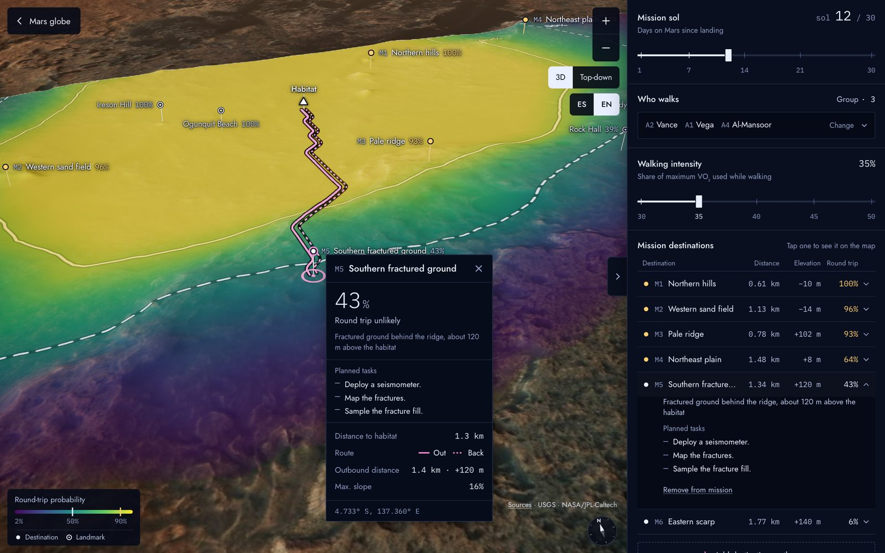
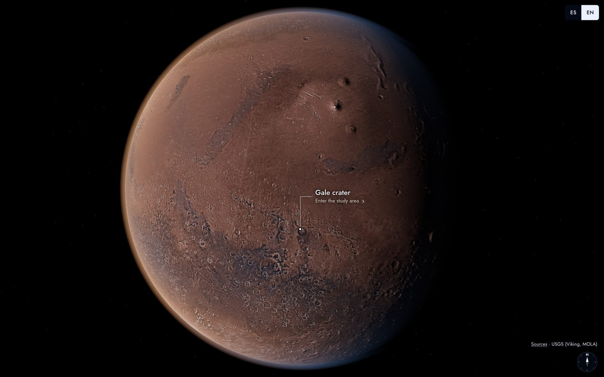
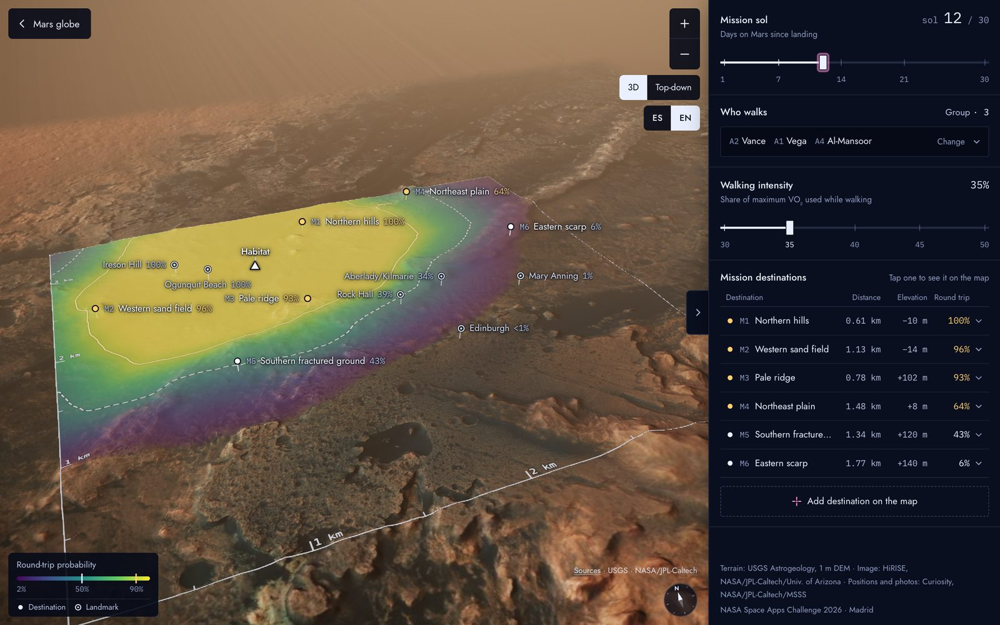
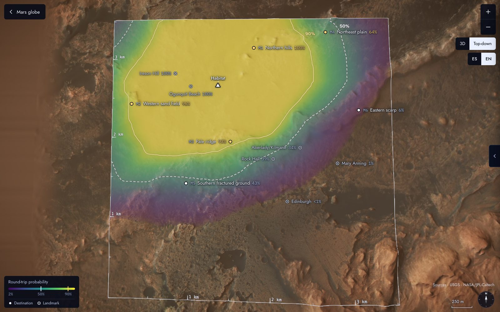
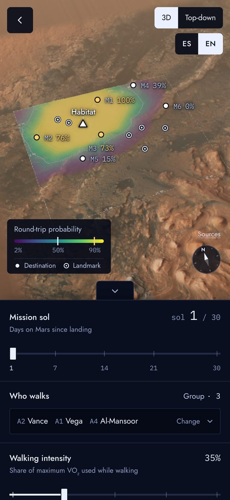
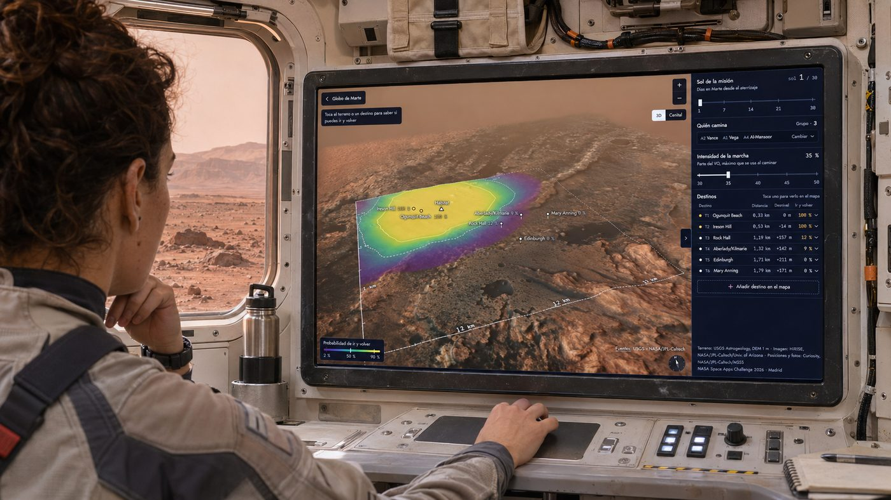
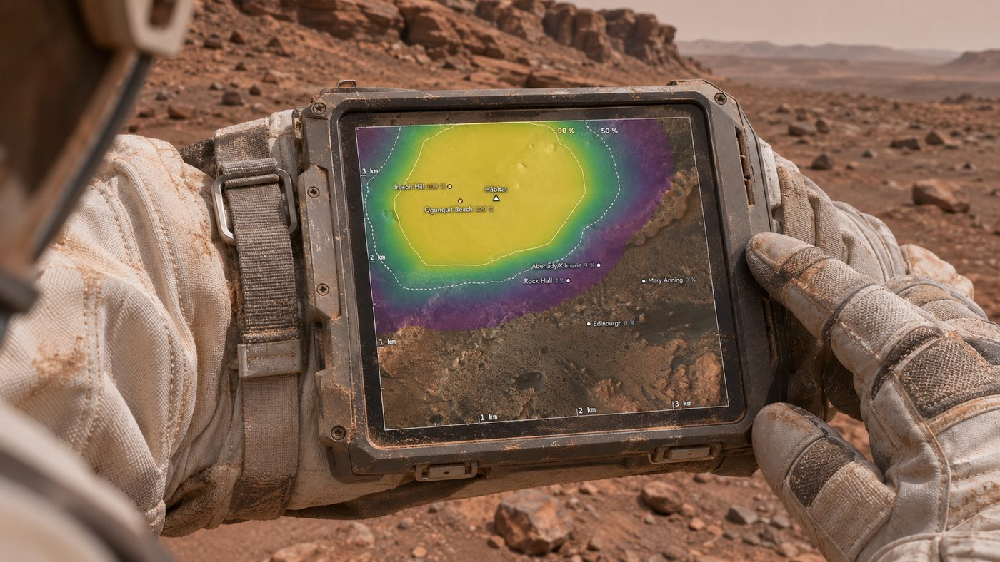
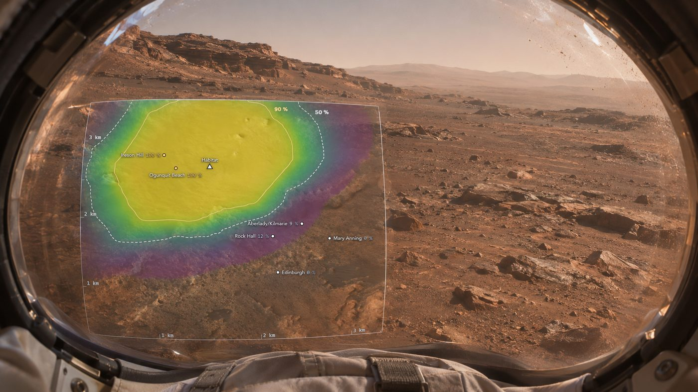

<div align="center">

# Land & Stand

**Mars as it looks to the body that walks it**

A project for the [NASA Space Apps Challenge 2026](https://www.spaceappschallenge.org/2026/) · Madrid<br>
Challenge: [*Interplanetary survival guide: Martian map*](https://www.spaceappschallenge.org/2026/challenges/interplanetary-survival-guide-martian-map/)


**English** · [Español](README.es.md)

</div>



> *Every team will map Mars. We map Mars as it looks to a body just back from six months in zero gravity.*

The first astronauts to set foot on Mars will arrive after some six months without gravity: with lower aerobic fitness, worse balance and less strength, and those deficits take days or weeks to fade. Earth is up to 24 light-minutes away, so nobody can guide them in real time.

**Land & Stand** shows, on the real terrain of Gale crater, **how likely each crew is to walk to every point and back**, depending on the mission sol (the Martian day since landing), who walks and how hard. Change the sol or the crew member, and the map changes.

## What you can do

- **Fly down from the Mars globe to Gale.** The whole planet with Viking color and MOLA relief; tap Gale crater and the camera descends to the study area, in 3D on the real terrain.
- **See what's reachable.** The round-trip probability is painted on the ground (viridis scale), with the 50% and 90% contours. The reachable area grows as the sols go by and the crew readapts.
- **Choose who walks.** One person, a pair or a group of any size, from eight astronaut profiles. A group moves at the pace of its most limited member.
- **Plan the mission destinations.** The plan starts with six proposed destinations (M1–M6); the crew can remove them or add their own by tapping the map. Tapping a destination in the panel flies the map to it.
- **Inspect any point.** Tapping the ground opens an info card with the probability, the distance, the lowest-energy route (out and back), the climb and the maximum slope. The card places itself so it doesn't cover the route, and lets you add that point to the mission.
- **Find your way with Curiosity.** The six sites the rover visited (T1–T6) are landmarks, with NASA's official image of what it saw there: 360° views, panoramas and photos, in a full-screen viewer.
- **Move freely.** 3D or top-down view, zoom down to 140 m above the ground, tilt almost to the horizon. The camera never goes through the terrain.
- **Use it in English or Spanish, on the ship's screen or a phone.** A language switch sits with the map controls. The panel floats over the map and hides with a tab; in portrait it moves to the bottom half. Without WebGL, a 2D map keeps the essentials.

| | |
|:---:|:---:|
|  |  |
| Mars globe (Viking + MOLA) | Study area in 3D, sol 12 |
|  |  |
| Top-down view, panel hidden | Phone |


### How it would be used on the mission

<table>
<tr>
<td></td>
<td></td>
<td></td>
</tr>
<tr>
<td align="center">On board, planning the EVA</td>
<td align="center">On the wrist, during the EVA</td>
<td align="center">On the helmet visor</td>
</tr>
</table>

<sub>Concept images generated with AI from real screenshots of the tool. They are not photographs.</sub>

## How it works

The computation follows the [algorithm specification](docs/algorithm-spec.md), which condenses the model's [technical report](docs/technical-report.md). Each part is a layer:

| Layer | What it computes | Code |
|---|---|---|
| 1 · Terrain | A 3.52 × 3.52 km study area in Gale, in 32 m cells, from the USGS 1 m elevation model | [`public/data/`](public/data/README.md) |
| 2 · Physiology | Recovery of aerobic capacity (VO₂max) and of balance (steepest walkable slope) as a function of the sol | [`fisiologia.ts`](src/lib/model/fisiologia.ts) |
| 3 · Suited walking | Sustainable speed and metabolic power on each slope (Minetti cost curve, capped Tobler speed, downhill limit) | [`marcha.ts`](src/lib/model/marcha.ts) |
| 4 · Graph | 8-neighbour graph with the distance and slope of each step, and its cost in time and energy | [`grafo.ts`](src/lib/model/grafo.ts) |
| 5 · Reachability | Energy-based Dijkstra from the habitat (out) and over the reversed graph (back). A cell is reachable if out + task + back fit within the suit's time and energy budget | [`alcanzabilidad.ts`](src/lib/model/alcanzabilidad.ts) |
| 6 · Uncertainty | 300-draw Monte Carlo over the physiological and suit parameters. A cell's probability is the share of draws in which it is reachable (for a pair or a group, for everyone at once) | [`montecarlo.ts`](src/lib/model/montecarlo.ts) |

**Where it runs.** In the browser. The 300 draws are split across several Web Workers (up to 6, depending on the cores) and the page adds up their counts: the result is identical to a single thread. A new change makes the running computation obsolete, so dragging a slider never queues work up. On a recent laptop, a group of three astronauts is computed in under a second.

**3D map performance.** The canvas only redraws when something changes (no GPU use at rest). The shadow map is computed once. Pointer picking intersects rays with the height grid instead of walking the terrain's 560,000 triangles. The panel floats over the map without resizing the canvas.

<details>
<summary><b>Architecture: the contract between computation, map and panel</b></summary>

The panel edits a `State`, the computation returns a `Result` and the map draws it. It is defined in [`src/lib/contract.ts`](src/lib/contract.ts) (the code uses Spanish names):

```ts
estado = {                          // state
  sol,                              // 1..30
  modo,                             // "tripulante" (solo) | "pareja" (pair) | "grupo" (group)
  tripulantes: [{ vo2pre, masa }],  // crew: pre-flight VO₂ and body mass
  fwalk,                            // walking intensity: "U" | 0.30 | 0.35 | 0.40 | 0.45 | 0.50
  energiaHoras,                     // suit energy budget in hours: 6 | 4
};

resultado = {                       // result
  prob: Float32Array(12100),        // 110 × 110, row 0 = SOUTH, column 0 = west
  elevacion: Float32Array(12100),   // elevation in metres, row 0 = SOUTH
  destinos: [{ id: "T3", p: 0.29 }, ...],
};
```

⚠️ The elevation model has **south in row 0**, but images have **north up**. The flip lives in one place only: [`src/lib/mapa/geo.ts`](src/lib/mapa/geo.ts).

The interface texts live in [`src/lib/i18n.ts`](src/lib/i18n.ts): a typed Spanish/English dictionary (a missing translation doesn't compile) and number formats per language.

</details>

<details>
<summary><b>The eight astronaut profiles</b></summary>

The tool is predictive: on arrival the crew can't measure their VO₂ or body mass on Mars, so it uses eight fixed profiles defined before flight ([`perfiles.ts`](src/lib/data/perfiles.ts)). They are fictional.

| ID | Name and role | Archetype | Pre-flight VO₂ (mL/kg/min) | Mass (kg) | Main trait |
|---|---|---|:---:|:---:|---|
| A1 | Dr. Elena Vega (commander) | Elite athlete | 55.0 | 68 | Fit for EVAs from sol 1; the longest reach |
| A2 | Dr. Marcus Vance (specialist) | ISS standard | 40.6 | 75 | Reference profile; fit from sol 7 |
| A3 | Eng. Lars Lindholm (cargo) | Heavy build | 44.0 | 92 | Strong aerobic engine, but drains the suit's energy sooner |
| A4 | Dr. Yasmine Al-Mansoor (geologist) | Light and efficient | 46.0 | 54 | Lowest consumption: the longest autonomy on long traverses |
| A5 | Dr. Alexei Morozov (astrobiologist) | Regulatory limit | 36.5 | 78 | Drops below the requirement after landing and takes weeks to recover |
| A6 | Dr. Chloe Bennett (pilot) | Balance deficit | 48.0 | 70 | Great endurance, but balance holds her back on steep slopes |
| A7 | Tech. Kenji Sato (robotics) | Severely deconditioned | 33.0 | 86 | The biggest drop from weightlessness; sets the pace of any group |
| A8 | Dr. Sarah O'Connor (flight surgeon) | Fast readaptation | 43.0 | 65 | Recovers very quickly: at 95% by sol 3 |

</details>

## Mission destinations and landmarks

- **Mission destinations (M1–M6).** A proposal by the team, not Curiosity sites: they were chosen on the elevation model and the HiRISE image to cover several directions, distances and climbs. With the default crew, M1 is at 100% from sol 1 and M6 is still unlikely on sol 30. The crew can remove them and add their own (P1, P2…).
- **Landmarks (T1–T6).** Curiosity's sampling sites on Mount Sharp (Ogunquit Beach, Ireson Hill, Rock Hall, Aberlady/Kilmarie, Edinburgh and Mary Anning), at their official positions and with their NASA Photojournal image. They help you find your way and can be added to the mission.

## Getting started

Requires Node.js 20.9 or later.

```bash
npm install
npm run dev      # http://localhost:3000  (add ?lang=en or ?lang=es to force a language)
```

| Command | What it does |
|---|---|
| `npm run dev` | Development server |
| `npm run build` then `npm start` | Production build |
| `npm test` | Tests (vitest): model, equivalence of the optimizations, 3D geometry, data and translations |
| `npm run lint` | ESLint |

The processed data is already in [`public/data/`](public/data/README.md), so nothing needs downloading to run the tool. To regenerate it from the official sources (Python with `rasterio`, `numpy` and `Pillow`):

```bash
python3 scripts/preparar_datos.py      # computation DEM, HiRISE background and relief
python3 scripts/preparar_datos_3d.py   # globe, Gale region and 3D terrain
```

## Project structure

```
src/
├── app/page.tsx              Screen: holds the state, mounts the map and the panel
├── lib/
│   ├── contract.ts           State, Result and worker messages
│   ├── constants.ts          Constants from the specification
│   ├── i18n.ts               Interface language: Spanish/English dictionary and number formats
│   ├── model/                Computation: layers 2 to 6 (with their tests)
│   ├── data/                 Habitat, destinations, landmarks, profiles, photos and sources
│   ├── mapa/                 Map geometry, contours and rasterizing
│   └── mapa3d/               3D coordinates, camera, mesh and ray picking
├── workers/modelo.worker.ts  Adds up its share of draws and computes routes
├── hooks/                    useModelo (splits the computation), useRuta, useTransicion…
└── components/
    ├── mapa3d/               3D map: globe, descent, terrain, labels, camera
    ├── mapa/                 2D fallback map, info card, legend, photo viewer, sources
    └── panel/                Sol, crew, intensity and mission destinations
public/
├── data/                     Processed elevation, images and heights (see its README)
└── fotos/                    Curiosity images of each landmark
scripts/                      Data preparation from the official sources
docs/                         Specification, technical report, style and sources (es/ has the Spanish originals)
```

The code (identifiers and comments) is in Spanish, the team's working language.

## Documentation

| Document | Contents |
|---|---|
| [Algorithm specification](docs/algorithm-spec.md) | The computation layers, their formulas, the validation protocol and common pitfalls. The reference for the code |
| [Technical report](docs/technical-report.md) | The scientific model, its results and its limitations |
| [Map style](docs/map-style.md) | Interface design: colors, layout, info card, camera and motion |
| [Data sources](docs/data-sources.md) | Every official source, with authorship, date, links and credit |
| [Original idea](docs/original-idea.md) | The initial proposal and what has changed since |

The Spanish originals are in [`docs/es/`](docs/es/), together with the specification with figures ([.docx](docs/es/especificacion_algoritmos.docx)).

## Limits

- **Never "safe".** The map shows what is *reachable under the stated assumptions*: the model, its parameters and the suit's energy and time budget. It does not replace the actual planning of an EVA.
- **Walking model M2 only.** Pandolf's equation doesn't reproduce the Mars data; the report keeps it as a sensitivity analysis.
- **Not in this version:** radiation, weather, dust storms, injuries and the landing-zone layer.
- **Fictional data where there is no real data:** the eight astronaut profiles and the proposed mission destinations.

## Data and credits

All data is public and shares the same projection (Mars equirectangular, central meridian 0°, R = 3,396,190 m). The full list, with sizes and checked details, is in [`docs/data-sources.md`](docs/data-sources.md); the tool shows it under "Sources".

| Data | Source | Use |
|---|---|---|
| Gale terrain, 1 m | [USGS Astrogeology · MSL Gale Merged DEM 1m v3](https://astrogeology.usgs.gov/search/map/mars_msl_gale_merged_dem_1m) (Calef and Parker, 2016) | Computation and 3D relief |
| Color image, 25 cm | [USGS Astrogeology · MSL Gale Merged Orthophoto Mosaic 25cm](https://astrogeology.usgs.gov/search/map/mars_msl_gale_merged_orthophoto_mosaic_25cm) · HiRISE, NASA/JPL-Caltech/University of Arizona | Map background |
| Curiosity positions | [NASA/JPL-Caltech · MSL waypoints (MMGIS)](https://mars.nasa.gov/mmgis-maps/MSL/Layers/json/MSL_waypoints.json) | Landmarks |
| Curiosity images | [NASA Photojournal](https://photojournal.jpl.nasa.gov/) · NASA/JPL-Caltech/MSSS, with their PIA numbers | Photo viewer |
| Mars globe | Viking MDIM 2.1 and MOLA (USGS, NASA/GSFC); Gale region with HRSC-MOLA 200 m | Globe and descent (visual only) |

## Team

Land & Stand · NASA Space Apps Challenge 2026, Madrid.<br>
Scientific model and reference: **Katrina Espinar Herranz**.
